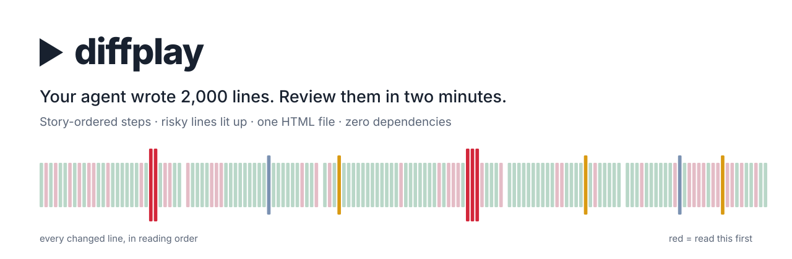
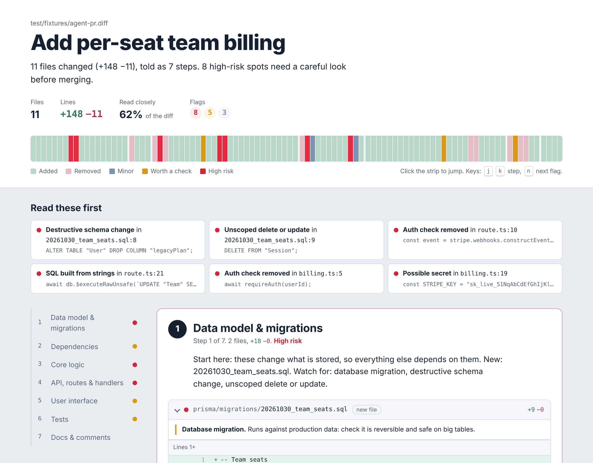
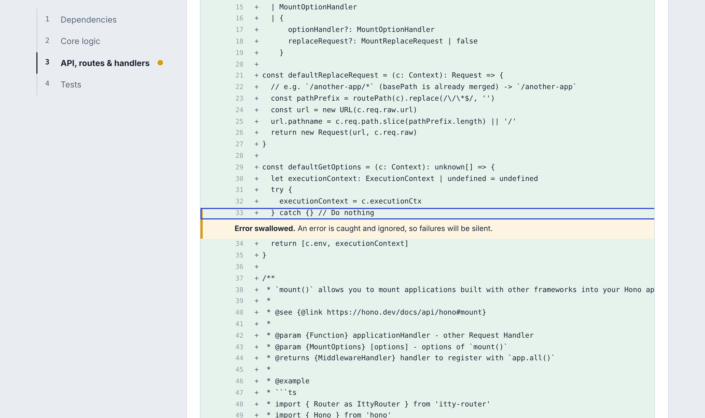
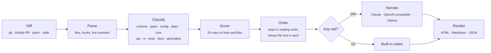

<div align="center">

<picture>
  <source media="(prefers-color-scheme: dark)" srcset="docs/banner-dark.svg">
  
</picture>

<br>

[](https://github.com/mohamedsaidyekhlef-png/diffplay/actions/workflows/ci.yml)
[](LICENSE)


**[Quick start](#-quick-start)** · **[What you get](#-what-you-get)** · **[GitHub Action](#-on-every-pull-request)** · **[The rules](#-the-rules)** · **[How it works](#-how-it-works)** · **[FAQ](#-faq)**

</div>

---

## The problem

Coding agents now write most of the diff. Claude Code, Codex, Cursor and Copilot open pull requests with 40 changed files, and the reviewer is left with two bad options: read every line, or skim and approve.

But the lines that hurt are almost never spread evenly. In a 2,000-line agent PR, the real problems are usually a handful of lines: a deleted auth check, a webhook that stopped verifying signatures, a `test.skip` that made CI green, a SQL string built with `${}`. A normal diff view gives those lines exactly the same weight as a renamed variable.

**diffplay gives them a different weight.** It turns any diff into a guided walkthrough:

1. **The change, in the order a human should read it.** Data model first, then config and dependencies, core logic, the API surface, the UI, the tests that should prove it, and the docs last. Lock files and generated code are folded away.
2. **The risky lines, lit up.** 26 rules flag the patterns that actually cause incidents, and each flag explains *why* in one plain sentence, right under the line.
3. **The whole PR at a glance.** A strip of every changed line, colored by risk. Click a red bar and you are on that line.

One command. One self-contained HTML file. No account, no server, no runtime dependencies.

<br>

<div align="center">

<br>
<sub>The walkthrough for the agent-style PR in diffplay's test suite: per-seat team billing, seeded with the mistakes coding agents typically make. Every one of them is caught.</sub>
</div>

<br>

## ⚡ Quick start

You need Node 18 or newer. Nothing is installed globally.

```bash
# In any git repo: everything on your branch vs main, including uncommitted work
# and brand-new files nobody has staged yet. The "what did my agent just do?" button.
npx github:mohamedsaidyekhlef-png/diffplay --open
```

That writes `diffplay.html` and opens it. More ways in:

```bash
npx github:mohamedsaidyekhlef-png/diffplay HEAD~3                       # any revision
npx github:mohamedsaidyekhlef-png/diffplay main..feature                # any range
npx github:mohamedsaidyekhlef-png/diffplay https://github.com/o/r/pull/42   # a GitHub PR
git diff --staged | npx github:mohamedsaidyekhlef-png/diffplay -        # anything piped in
npx github:mohamedsaidyekhlef-png/diffplay --diff change.patch          # a patch file
```

> **Tip** — install it once and the command is just `diffplay`:
> ```bash
> npm install -g github:mohamedsaidyekhlef-png/diffplay
> ```

What you see in the terminal (real output, from the test-suite PR):

```text
Add per-seat team billing
11 files changed (+148 −11), told as 7 steps. 8 high-risk spots need a careful look before merging.

11 files  +148 −11  ·  read closely: 62%  ·  8 high  5 medium  3 minor

  ● 1. Data model & migrations (2)
  ● 2. Dependencies (1)
  ● 3. Core logic (2)
  ● 4. API, routes & handlers (1)
  ● 5. User interface (2)
  ● 6. Tests (1)
  ○ 7. Docs & comments (1)
     ! Destructive schema change: prisma/migrations/20261030_team_seats.sql:8
     ! Unscoped delete or update: prisma/migrations/20261030_team_seats.sql:9
     ! Auth check removed: src/app/api/billing/webhook/route.ts:10
     ! SQL built from strings: src/app/api/billing/webhook/route.ts:21
     ! Auth check removed: src/lib/billing.ts:5

→ diffplay.html
```

<br>

## ✦ What you get

<table>
<tr>
<td width="50%" valign="top">

### The strip
Every changed line in the PR, left to right in reading order, one bar each. Green is added, pink is removed, and the colored bars are flags. Gaps mark step boundaries. You can see in one glance whether a PR is "big but boring" or "small and scary". Click any bar to jump to its line.

### Read these first
The most serious flags, one per file and rule, so one noisy pattern can't bury the rest. Each links straight to its line.

### Steps, not files
Files are grouped by what they are and ordered the way you would explain the change to a colleague. Each step says why it exists and what to watch for.

</td>
<td width="50%" valign="top">

### Flags with reasons
A flagged line gets a colored edge and a one-sentence note directly beneath it: what the pattern is and what could go wrong. No scores to decode.

### Less noise
Lock files, minified bundles, snapshots, source maps and pure renames are hidden. Files with nothing risky and lots of lines start collapsed.

### Built for reading
Keyboard: <kbd>j</kbd> / <kbd>k</kbd> step by step, <kbd>n</kbd> jumps flag to flag. Light and dark mode follow your system. Works on a phone. Prints cleanly. The HTML file has no external scripts and works offline (fonts fall back to system fonts).

</td>
</tr>
</table>

### On real code

This is diffplay on a real commit from [Hono](https://github.com/honojs/hono): the PR that introduced the Mount middleware, +454 lines. It flagged one thing worth a second look: an error caught and ignored. Here the authors meant it (`// Do nothing`), and the walkthrough lets a reviewer confirm that in two seconds instead of finding it by chance.

<div align="center">

</div>

<br>

## 🔁 On every pull request

Add one file and every PR gets a walkthrough. diffplay posts a single comment (updated in place on each push), attaches the full HTML walkthrough to the run, and writes the summary to the job page.

```yaml
# .github/workflows/diffplay.yml
name: diffplay
on: pull_request

permissions:
  contents: read
  pull-requests: write

jobs:
  walkthrough:
    runs-on: ubuntu-latest
    steps:
      - uses: mohamedsaidyekhlef-png/diffplay@v0
        with:
          anthropic-api-key: ${{ secrets.ANTHROPIC_API_KEY }}   # optional: plain-English narration
          fail-on: high                                          # optional: block merges on high-risk flags
```

No checkout step is needed: the Action reads the PR diff from the GitHub API.

<details>
<summary><b>All inputs and outputs</b></summary>

<br>

| Input | Default | What it does |
|---|---|---|
| `github-token` | `${{ github.token }}` | Reads the PR and posts the comment. |
| `anthropic-api-key` | — | Claude writes the narration. |
| `openai-api-key` | — | Any OpenAI-compatible API writes the narration. |
| `openai-base-url` | — | Base URL for OpenRouter, Groq, Together, a self-hosted gateway… |
| `model` | provider default | Model name override. |
| `fail-on` | — | `high`, `medium` or `low`: fail the check if any flag is at that level or above. |
| `comment` | `true` | Set to `false` to skip the PR comment and keep only the artifact and job summary. |

| Output | |
|---|---|
| `high` | Number of high-risk flags |
| `medium` | Number of worth-a-check flags |
| `low` | Number of minor flags |

Pull requests from forks run with a read-only token, so GitHub won't let any Action comment on them. diffplay detects this, warns instead of failing, and still writes the summary to the job page.

</details>

<br>

## 🗣 Plain-English narration (optional)

diffplay works fully without any AI: the steps, ordering, flags and notes all come from static analysis. Add a key and a model reads the ordered steps and writes:

- a real **title** for the PR,
- a **summary** that ends with the single most important thing to check,
- one or two sentences per step explaining **why** it exists, and pointing out anything inconsistent between steps.

| Provider | Set this | Default model |
|---|---|---|
| **Claude** | `ANTHROPIC_API_KEY` | `claude-sonnet-5-5` |
| **OpenAI**, or any compatible API (OpenRouter, Groq, Together…) | `OPENAI_API_KEY`, optionally `OPENAI_BASE_URL` | `gpt-5-mini` |
| **Ollama**, fully local and offline | `DIFFPLAY_OLLAMA=1`, optionally `OLLAMA_HOST` | `qwen2.5-coder:7b` |

Set `DIFFPLAY_MODEL` to use any other model. Use `--no-ai` to skip narration even when a key is set.

**Privacy:** the diff goes only to the provider *you* configure, and only when a key is set. There is no diffplay server, no telemetry, no account. If the model call fails for any reason, diffplay keeps its built-in notes and still writes the walkthrough.

<br>

## 🚦 The rules

Every rule is a pattern, a severity, and one sentence of why. They are tuned to stay quiet on ordinary code: test files, docs and import lines are excluded where a rule would be noisy there, placeholders like `"your-api-key"` are ignored, a moved test is not a deleted test, and assertions that move between files are not a loss.

<details open>
<summary><b>🔴 High — read before merging</b></summary>

<br>

| Rule | Catches |
|---|---|
| Possible secret | Live-format keys: AWS `AKIA…`, OpenAI/Anthropic `sk-…`, Stripe `sk_live_…`, GitHub `ghp_…`, Slack `xox…`, Google `AIza…`, private key blocks |
| Hardcoded credential | `password = "…"`, `api_key: "…"`, `access_token = "…"` written into source |
| Destructive schema change | `DROP TABLE/COLUMN`, `TRUNCATE`, `dropColumn`, `remove_column`, `op.drop_…` |
| Unscoped delete or update | `DELETE FROM x;` with no `WHERE`, `deleteMany({})`, `rm -rf /` style commands |
| Auth check removed | Deleted lines that called `requireAuth`, `getServerSession`, `jwt.verify`, `@login_required`, `@UseGuards`, webhook `constructEvent`, `timingSafeEqual`… |
| Dynamic code or shell execution | `eval`, `new Function`, `child_process`, `exec`, `subprocess(..., shell=True)` |
| SQL built from strings | Queries built with `${}`, `+`, `%s` or f-strings, `$queryRawUnsafe`, `$executeRawUnsafe` |
| Security setting weakened | `verify=False`, `rejectUnauthorized: false`, CORS `*`, `csrf: false`, `@csrf_exempt`, `--no-verify` |
| Environment file changed | A real `.env` committed (`.env.example` is fine) |
| Test file deleted | A whole test file removed, unless it reappears elsewhere in the same diff |

</details>

<details>
<summary><b>🟠 Worth a check</b></summary>

<br>

| Rule | Catches |
|---|---|
| Raw HTML injection | `dangerouslySetInnerHTML`, `.innerHTML =`, `v-html`, `|safe`, `mark_safe` |
| Error swallowed | `catch {}`, `except: pass`, `.catch(() => {})`, `rescue nil` |
| Test skipped or weakened | `.skip`, `.only`, `xit`, `@pytest.mark.skip`, `expect(true).toBe(true)` (conditional `skipif` is fine) |
| Fewer assertions | The change as a whole removes more assertions than it adds (tests moved between files don't count) |
| Payment API call | `stripe.x.create/update/refund`, `paymentIntents.create`, `refunds.create`… |
| Debug flag on | `DEBUG = True`, `debug: true`, `app.run(debug=True)` |
| Database migration | Any file under a migrations folder |
| CI / deploy pipeline changed | GitHub workflows, GitLab CI, CircleCI, Jenkinsfile, Dockerfile, Vercel and Netlify config |
| Dependency added or bumped | New or changed entries in `package.json`, `requirements.txt`, `pyproject.toml`, `Cargo.toml`, `go.mod`, `Gemfile`… (not your own version field) |

</details>

<details>
<summary><b>🔵 Minor</b></summary>

<br>

| Rule | Catches |
|---|---|
| Type safety bypassed | `@ts-ignore`, `as any`, `eslint-disable`, `# type: ignore`, `# noqa` |
| TODO or placeholder | `TODO`, `FIXME`, `HACK`, "not implemented", stubs |
| Debug output left in | `console.log`, `debugger`, `print(`, `var_dump`, `binding.pry` (not in CLIs and scripts) |
| Auth logic changed | Edits touching sessions, tokens, roles, passwords, OAuth |
| Money math | Arithmetic on prices, amounts, balances, fees and taxes |
| New outbound call | New `fetch`, `axios`, `requests` or WebSocket calls to hard-coded URLs |
| Very large change | One file with more than 400 changed lines |

</details>

### How quiet is it?

A flag nobody believes is worse than no flag, so the rules are tested against real history, not just examples. On the 55 most recent commits of three popular projects in three languages:

| Project | Language | Commits | Changed lines | High-risk flags | Time |
|---|---|---|---|---|---|
| [Hono](https://github.com/honojs/hono) | TypeScript | 55 | 8,939 | **0** | 92 ms |
| [FastAPI](https://github.com/fastapi/fastapi) | Python | 55 | 9,030 | **0** | 88 ms |
| [Bubble Tea](https://github.com/charmbracelet/bubbletea) | Go | 55 | 1,997 | **0** | 56 ms |

The "worth a check" flags they did raise were dependency and CI changes, a test refactor that dropped a few assertions, and intentionally empty `catch` blocks: exactly what a reviewer should glance at. Reproduce it on any repo:

```bash
git clone --depth 60 https://github.com/honojs/hono && cd hono
for c in $(git log --format=%h -n 55); do
  git show --format= -M $c | npx github:mohamedsaidyekhlef-png/diffplay - --no-ai -q -o /dev/null --fail-on high || echo "high flag in $c"
done
```

If a rule is noisy on your code, [open an issue](https://github.com/mohamedsaidyekhlef-png/diffplay/issues) with the line. False positives are bugs.

<br>

## 🧭 How it works



- **Parsing** follows each hunk's declared line counts, so a deleted SQL comment such as `-- note` is never mistaken for a file header. Totals match `git diff --shortstat` exactly.
- **Classification** is by path: `migrations/`, `*.sql` and `schema.prisma` are the data model; `route.ts`, `controllers/` and `middleware/` are the API surface; `*.test.ts` and `tests/` are tests; lock files and `dist/` are generated. Anything else is core logic.
- **"Read closely"** is the share of changed lines inside hunks that contain at least one high or worth-a-check flag. It tells you how much of the PR deserves real attention.
- **Speed:** 200 files and 8,000 changed lines take about a quarter of a second, and the resulting page opens in under a second.

<br>

## 📖 CLI reference

```text
diffplay [target] [options]
```

| Target | Meaning |
|---|---|
| *(none)* | This branch plus uncommitted work and untracked files, against `origin/HEAD`, `origin/main`, `origin/master`, `main` or `master` (first found). Untracked files over 1 MB and diffplay's own output are skipped |
| `HEAD~3`, `main..feature`, `abc123` | Any git revision or range |
| `https://github.com/o/r/pull/42` | A GitHub PR. Uses the `gh` CLI if installed (private repos work), otherwise the public diff |
| `-` or piped input | Any unified diff on stdin |

| Option | |
|---|---|
| `-o, --out <file>` | HTML output path (default `diffplay.html`) |
| `--open` | Open the walkthrough in your browser |
| `--md [file]` | Also write the Markdown PR-comment summary; prints to stdout without a file |
| `--json <file>` | Write the full walkthrough as JSON |
| `--title <text>` | Set the title yourself |
| `--pr <n>` | A PR in the current repo (needs `gh`) |
| `--diff <file>` | Read a diff or patch file |
| `--no-ai` | Skip narration even if a key is set |
| `--fail-on <level>` | Exit with code 2 if any flag at `high`, `medium` or `low` or above |
| `-q, --quiet` | No terminal summary |
| `-v, --version`, `-h, --help` | |

Exit codes: `0` success, `1` usage or input error, `2` risk gate failed.

### Use it from code

```ts
import { buildWalkthrough, renderHtml, renderMarkdown, detectProvider, narrate } from "diffplay";

const walkthrough = buildWalkthrough(diffText, { title: "Add team billing" });

const provider = detectProvider();               // reads the same env vars as the CLI
if (provider) await narrate(walkthrough, provider);

const html = renderHtml(walkthrough);            // one self-contained page
const comment = renderMarkdown(walkthrough);     // GitHub-flavoured summary
console.log(walkthrough.stats.risks);            // { high, medium, low }
```

<br>

## ❓ FAQ

<details>
<summary><b>Does this replace code review?</b></summary>
<br>
No. It makes review possible at the speed agents write code. diffplay decides what order to read things in and where to look hardest; a human still decides whether the change is right.
</details>

<details>
<summary><b>How is this different from AI review bots?</b></summary>
<br>
Review bots leave dozens of comments on the PR and ask you to trust their judgement. diffplay reorganises the diff itself so <i>you</i> can judge it quickly, and every flag comes from a rule you can read in <code>src/risk.ts</code>. It runs locally, needs no account, and works with no AI at all. Use both if you like.
</details>

<details>
<summary><b>Which languages does it understand?</b></summary>
<br>
It works on any text diff. The ordering understands common layouts for JavaScript/TypeScript, Python, Go, Ruby, Rust, Java/Kotlin and PHP projects, and the rules cover the patterns those ecosystems share: SQL, shells, secrets, auth, tests and config.
</details>

<details>
<summary><b>Will it choke on a huge PR?</b></summary>
<br>
No. Parsing and scoring are linear and fast. Generated files are hidden, quiet files start collapsed, and narration trims each file to keep the model prompt bounded.
</details>

<details>
<summary><b>Does my code leave my machine?</b></summary>
<br>
Only if you set a model key, and then only to that provider. Without a key, nothing is sent anywhere. With <code>DIFFPLAY_OLLAMA=1</code>, narration also stays on your machine.
</details>

<br>

## 🛣 Roadmap

- [ ] **Proof, not trust** — run the app and attach before/after screenshots and test results to each step
- [ ] **Ask the diff** — click any line and ask why it changed, answered from the agent's own session log
- [ ] **MCP server** — Claude Code, Codex and Cursor hand you a walkthrough the moment they finish
- [ ] Hosted walkthrough pages for the GitHub Action, so the comment links to a page instead of a download
- [ ] GitLab and Bitbucket support
- [ ] Per-repo rule config (`.diffplay.json`): turn rules off, add your own

<br>

## 🤝 Contributing

The fastest way to help is a new rule or a false-positive report. A rule is a few lines in [`src/risk.ts`](src/risk.ts):

```ts
{ id: "my-rule", label: "Short name", severity: "medium", on: "add",
  why: "One sentence a reviewer would want to read.",
  re: /the pattern/,
  skipPath: TEST_OR_DOC },
```

Add a case to [`test/core.test.mjs`](test/core.test.mjs) showing it fires on the bad line and stays quiet on a good one, then:

```bash
npm install
npm test
```

<br>

## License

[MIT](LICENSE) © 2026 Mohamed Said Yekhlef

<div align="center">
<br>
<sub>If diffplay caught something before it shipped, a ⭐ helps other reviewers find it.</sub>
</div>
